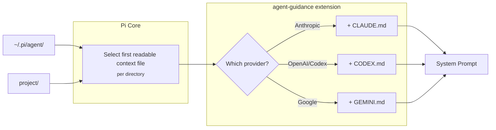

# pi-agent-guidance

Loads provider-specific context files (CLAUDE.md, CODEX.md, GEMINI.md) based on the current model, supplementing Pi's selected context files, and delivers the context files of subdirectories the agent works in.

## How it works



| Provider | File |
|----------|------|
| Anthropic | CLAUDE.md |
| OpenAI / Codex | CODEX.md |
| Google | GEMINI.md |

### Pi Core behavior

Pi Core selects the first readable regular file per directory in this order:
`AGENTS.override.md`, `AGENTS.md`, `AGENTS.MD`, `CLAUDE.md`, `CLAUDE.MD`.
It searches the agent directory and project ancestors (walking up from cwd).
An override replaces only the context file in its own directory; unreadable
files and directories are skipped.

### What this extension adds

For each directory, loads a readable provider-specific regular file unless its
resolved path or content already appears in the host's actual
`before_agent_start.systemPromptOptions.contextFiles`. This includes custom host
context selections. A `CLAUDE.md` alongside a different `AGENTS.override.md` is
still Claude-specific guidance, and an unselected `AGENTS.md` cannot suppress a
matching `CODEX.md`. On older hosts without structured prompt options, the
fallback uses the same precedence and readability rules. Supplemental files are
also deduplicated against each other. On structured hosts, guidance occupies the
`provider_context` section without forcing a full prompt replacement, so later
policy, context, and tool changes remain effective. An intentional earlier full
prompt replacement is preserved with guidance appended.

### Subdirectory context

Pi loads context files only from the agent directory, the working directory
and its ancestors. When the agent successfully reads, edits or writes a file
below the working directory, this extension delivers the context files of each
directory between that file and the working directory, once, appended to that
tool result:

- Per directory it takes the file Pi Core would select there (same precedence
  as above) plus the current model's provider files, from the table above or
  your `providers`/`models` configuration. Outer directories come first.
- A file whose resolved path or content is already in the system prompt is
  skipped. So are directories at or below a `node_modules` segment, paths whose
  real location is outside the working directory (a symlink cannot reach out),
  and calls issued by another tool rather than the model.
- Each file is capped at 16 KiB, truncated with a note naming the file. One
  turn delivers at most 32 KiB; files over that budget are named in a short
  note and load with the next file operation below them in a later turn.
- Nothing is delivered unless the project is trusted (`ctx.isProjectTrusted()`):
  nested files in an untrusted checkout are a prompt-injection vector. Pi's own
  context loading is unchanged.
- A full `read` or a `write` of a context file counts as delivering it; a
  partial read or an edit does not.

Each delivery is recorded as a `pi-agent-guidance:subdirectory-context` custom
session entry, which is not sent to the model. Whether a file was delivered is
derived from the current branch's compaction-aware context entries, not from
process memory: after compaction summarizes the delivering tool result away,
after `/tree` moves to a branch that never saw it, or after a context edit
replaces that result, the file is delivered again. Resuming a session does not
repeat a delivery. A file whose content changed is delivered again.

The text is appended to the tool result rather than sent as a hidden steering
message. It is then part of the result the model reads when it first touches
that directory, before it acts on the file; it appears in the transcript under
the tool call that caused it; and compaction summarizes it together with that
call. A steering message would arrive only after the whole tool batch, as a
separate user-role message the user does not see, and would queue alongside
other steering and follow-up messages.

## Install

### Pi package manager

```bash
pi install npm:@signalridge/pi-agent-guidance
```


Then filter to just this extension in `~/.pi/agent/settings.json`:

```json
{
  "packages": [
    {
      "source": "npm:@signalridge/pi-agent-guidance",
      "extensions": ["./agent-guidance.ts"]
    }
  ]
}
```

### Local clone (setup script)

```bash
./setup.sh
```

Links the extension to `<agent-dir>/extensions/` and helps you set up
`<agent-dir>/AGENTS.md`. The agent directory defaults to `~/.pi/agent`; set
`PI_CODING_AGENT_DIR` to use another profile. A leading `~` or `~/` is expanded
as it is by Pi. Configuration and provider files belong in the same directory.

## Templates

`templates/` ships provider **context files**, not Agent Skills: they are plain guidance
Pi concatenates into the system prompt, so they carry no skill frontmatter and are
deliberately absent from this package's `pi.skills`.

Starter templates in `templates/`:
- `CLAUDE.md` - Claude-specific guidelines
- `CODEX.md` - OpenAI guidelines: `<solution_persistence>` (bias for action, persist till the task is done) and `<validation>` (run tests/lint/typecheck/build before summarizing or committing)
- `GEMINI.md` - Gemini guidelines: `<tool_usage_rules>` steering the model to pi's `read`/`write`/`edit` tools instead of `cat`/`heredoc`/`sed -i`/etc.

Install with:
```bash
ln -s "$(pwd)/agent-guidance/templates/CLAUDE.md" ~/.pi/agent/
```

## Configuration (optional)

Create `~/.pi/agent/agent-guidance.json`:

```json
{
  "providers": { "anthropic": ["CLAUDE.md"] },
  "models": { "claude-3-5*": ["CLAUDE-3-5.md"] }
}
```

Model patterns are case-insensitive: `*` matches any characters, while all other
characters are literal. The first matching model pattern takes precedence over
provider configuration and built-in defaults. Empty arrays intentionally disable
loading. Both `providers` and `models` must map names to arrays of strings;
invalid configuration emits one warning naming the file and uses defaults.

Subdirectory context is on by default. Disable it with:

```json
{ "subdirectoryContext": false }
```

Any non-boolean value is invalid configuration.

## Provenance

Subdirectory context is adapted from Anton Kuzmenko's MIT-licensed
[`default-anton/pi-subdir-context`](https://github.com/default-anton/pi-subdir-context),
commit `c63f487`: deliver unseen nested context files on `read`, appended to
the tool result. This version derives delivery from the session branch instead
of an in-memory set, so compaction, `/tree` and resume stay correct; also
covers `edit` and `write`; applies the provider-specific file selection; caps
size per file and per turn; requires project trust; drops the home-directory
fallback; checks containment on real paths; and skips `node_modules` and
tool-issued nested calls.

## Changelog

See `CHANGELOG.md`.
