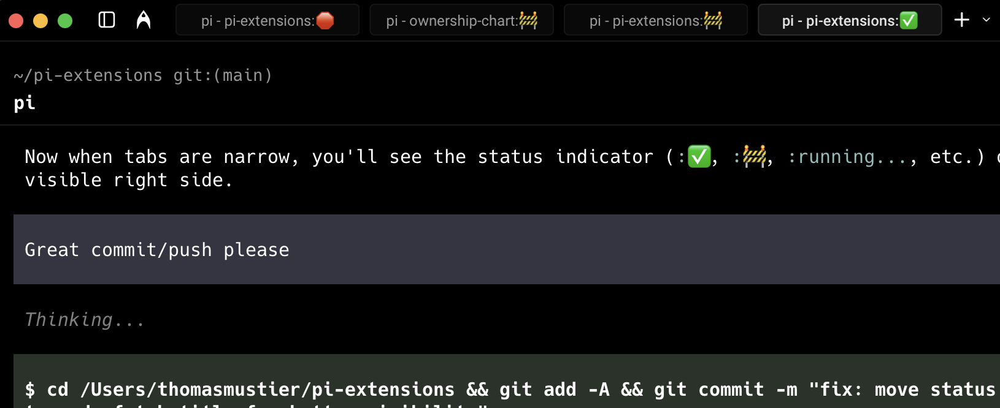

# pi-tab-status

Manage as many parallel Pis as your mind can handle without forgetting any of them.

Adds a compact status to tab titles:

- The optional `ridgeline` style uses `pi · project · working|done|review|blocked`.
- The default `legacy` style keeps the original emoji indicators: ✅ committed, 🚧 review needed, 🛑 blocked/error, and `running...` while active.
- `blocked` means no messages or tool calls for 180s while running, or an agent error. A tool that is still executing keeps the tab in `running...` even when it emits no intermediate events, so a long command is never reported as blocked.
- A run you abort, for example with Escape, returns the tab to its bare `pi - project` title instead of showing it as done or review. Pi 1.1 and later report the abort on `agent_settled`; with older hosts it is inferred from the run's last stop reason.

The more tabs you have open, the better it is. **Currently tracks one active session per tab.**



## Install

### Pi package manager

```bash
pi install npm:@signalridge/pi-tab-status
```

```bash
pi install npm:@signalridge/pi-tab-status
```

Then filter to just this extension in `~/.pi/agent/settings.json`:

```json
{
  "packages": [
    {
      "source": "npm:@signalridge/pi-tab-status",
      "extensions": ["tab-status.ts"]
    }
  ]
}
```

### Local clone

```bash
ln -s "$(pwd)/packages/pi-tab-status/tab-status.ts" ~/.pi/agent/extensions/
```

Or add to `~/.pi/agent/settings.json`:

```json
{
  "extensions": ["./packages/pi-tab-status/tab-status.ts"]
}
```

Set the original Signalridge style with:

```sh
PI_TAB_STATUS_STYLE=ridgeline
```

The environment variable is user-overridable; the package still defaults to the legacy style when it is unset.

## Desktop notifications

Off by default. Enable them with:

```sh
PI_TAB_STATUS_NOTIFY=1
```

An interactive (TUI) session then raises one desktop notification:

- when a run settles: `Finished with a commit`, `Finished, ready for review` or `Run ended with an error`. A run you abort, for example with Escape, settles silently.
- when the tab enters `blocked` because a run has been quiet for 180s: `No activity for 3 minutes`. It fires once per entry; new activity leaves the state, and a later stall notifies again.

The notification title is the tab's project label and the body is one of the fixed texts above; prompts and model output are never included. Print, JSON and RPC sessions never notify, and neither do subagent child sessions, which run without the TUI.

The escape sequence is chosen from the terminal's environment:

| Environment | Sequence |
| --- | --- |
| `KITTY_WINDOW_ID` is set | OSC 99 (kitty) |
| `TERM_PROGRAM=iTerm.app`, `ITERM_SESSION_ID` or `LC_TERMINAL=iTerm2` | OSC 9 (iTerm2) |
| anything else | OSC 777 (Ghostty, WezTerm, rxvt-unicode) |

Detection is heuristic. Inside tmux, for example, `TERM_PROGRAM` names tmux rather than the outer terminal. To force a protocol, set `PI_TAB_STATUS_NOTIFY` to `osc777`, `osc9` or `osc99` instead of `1`. Any other value leaves notifications off. When `TMUX` is set, the sequence is wrapped in tmux's passthrough, which tmux 3.3 and later forward only with `set -g allow-passthrough on`. Terminals that implement none of these sequences ignore them. The package only writes escape sequences: it never starts a process, so there is no PowerShell toast for Windows Terminal and no sound hook.

### Pi's native program status

Pi reports its own state with the Program Status Protocol (OSC 7501) to terminals that answer its support query. That report feeds the terminal's or an agent dashboard's status display. It does not raise a desktop notification, and tmux and screen do not forward it. Its `blocked` state also means something different: an extension dialog or login is waiting, whereas this package's `blocked` means the run went quiet or ended with an error. The notifications here are a separate, opt-in channel that asks the terminal for a desktop notification and passes through tmux.

To avoid double alerts:

- Keep one notifier per session. Do not enable this setting together with another notification extension, such as `pi-notify` or Pi's `notify.ts` example.
- If your terminal or dashboard already alerts on Pi's OSC 7501 `done` and `blocked` states, leave `PI_TAB_STATUS_NOTIFY` unset. Alternatively, keep these notifications and set `PI_PROGRAM_STATUS=0` to stop Pi's native reports, which also removes the native status display.

The tab title behaves the same whether or not notifications are enabled.

## Todo

- [x] Status indicators in terminal tabs
- [ ] Central location to view and navigate to specific tabs across terminal windows

## Provenance

The desktop notifications adapt two MIT-licensed sources: the per-terminal
OSC 777/9/99 selection and tmux passthrough from
[`ferologics/pi-notify`](https://github.com/ferologics/pi-notify) (`index.ts`,
commit `a17c63e`), and settling on `agent_settled` rather than `agent_end` from
Pi's `packages/coding-agent/examples/extensions/notify.ts` in
[`earendil-works/pi`](https://github.com/earendil-works/pi) (commit `25426f7`).

The local version diverges: it is off unless `PI_TAB_STATUS_NOTIFY` enables it
and accepts a forced protocol; it notifies only in TUI sessions, skips aborted
runs and also notifies once per entry into this package's stalled `blocked`
state; it strips control characters, bidi overrides and `;` from both fields
and caps their length; it also recognizes iTerm2 through `LC_TERMINAL`; and it
drops the Windows PowerShell toast and the shell sound hook, so it never starts
a process.

## Changelog

See `CHANGELOG.md`.
