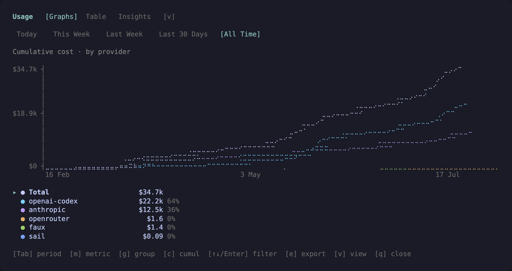
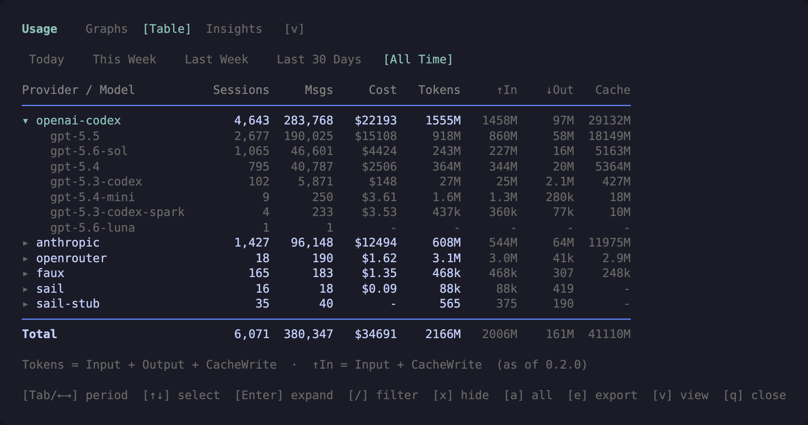
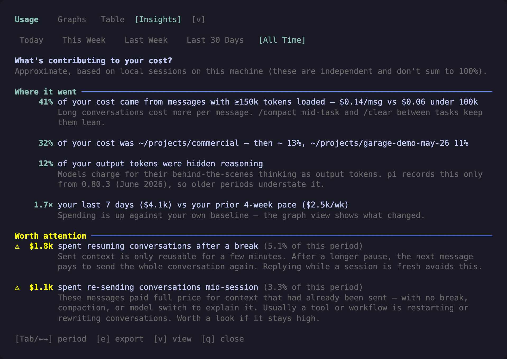

# pi-usage-extension

A Pi extension that displays aggregated usage statistics across all sessions.



## Compatibility

- **Tested Pi host:** `1.4.0` — see the `peerDependencies` range for installation compatibility.

Older sessions still parse without newer entry types. Pi 0.81+ auxiliary tool/summary usage and 0.87+ standalone model usage are included without inventing assistant messages. See [Data source](#data-source) for reconciliation and branch-aware accounting; wildcard host peers do not establish universal compatibility.

## Install

### Pi package manager

```bash
pi install npm:@signalridge/pi-usage-extension
```

Optional resource filter in `~/.pi/agent/settings.json` (the manifest already loads only index.ts):

```json
{
  "packages": [
    {
      "source": "npm:@signalridge/pi-usage-extension",
      "extensions": ["index.ts"]
    }
  ]
}
```

### Local clone

Add to your `~/.pi/agent/settings.json`:

```json
{
  "extensions": [
    "./packages/pi-usage-extension"
  ]
}
```

## Usage

In Pi, run:
```
/usage
```

## Features

### Views

`/usage` has three view modes, shown as a tab strip in the title and cycled with `v`:

- **Graphs** (default) — an interactive braille line-chart explorer for usage over time (screenshot at the top of this page, details below).
- **Table** — per-provider / per-model stats with cost and token breakdown, with keyboard filtering (details below).
- **Insights** — data-driven characteristics of your cost for the active time period (details below). Insights are **independent lenses**, not a breakdown, so they overlap and don't sum to 100%.

Every view can export its current slice with `e` — see [Export](#export).



### Filtering the table

- `/` opens a live type-to-filter over provider **and** model names (case-insensitive substring). When only models match, the provider row is recomputed from just the matching models — filtering `sol` shows openai-codex as exactly its `gpt-5.6-sol` numbers. `Enter` keeps the filter, `Esc` clears it.
- `x` hides the selected provider row; `a` resets all hides and the filter.
- The **Total row recomputes over the visible slice**, and a status line makes the cut explicit so a filtered table can't be mistaken for the full period.



### Insights

The **Insights** view has two sections, facts first:

**Where it went** — always-on structural lenses:

| Insight | Detail |
|---|---|
| Tool and summary usage | share of cost reported by nested tool calls, compaction, and branch summarization (Pi 0.81.0+) |
| Context tax | share of cost spent at ≥ 150k context, with the average per-message cost vs messages under 100k |
| Project mix | top 3 project directories by cost, derived from each session's working directory (worktrees collapse into their repository; hidden when one project is ≥ 90% — you already know) |
| Reasoning share | share of output tokens that were hidden reasoning (recorded by pi 0.80.3+ only; hidden below 5%) |
| Burn trend | your last 7 days of spend vs your prior 4-week weekly pace (same on every tab) |

**Worth attention** — spend alarms only appear when a wasteful pattern is material for the period. Accounting-integrity warnings appear whenever unresolved overlap is retained, regardless of cost. When nothing is flagged, the section shows an explicit all-clear. Large-context cache misses are split into three distinct behaviours:

| Alarm | Fires when |
|---|---|
| Unresolved tool overlap | partial child cost/token vectors cannot prove an exact reconciliation; retained reports may double-count scanned usage, even at zero or unknown cost |
| Resuming after a break | ≥ 2% of the period's cost (and ≥ $1) went to messages that re-sent a large conversation from scratch after a > 5 min idle gap — provider caches expire after a few minutes idle |
| Switching models mid-conversation | ≥ 2% of cost (and ≥ $1) went to large-context misses right after the provider/model changed mid-session — the previous model's cache doesn't transfer |
| Mid-session re-sends (prefix change) | ≥ 2% of cost (and ≥ $1) went to large-context misses with **no** idle gap, compaction, or model switch to explain them — something rewrote the request prefix |
| Session concentration | the top 5 sessions account for ≥ 35% of the period's cost |
| Upfront tax | ≥ 8% of cost was the first message of a session (session starts pay for their whole prompt uncached) |
| Cache leverage floor | fewer than 5 cached tokens served per fresh token paid (shown only above $5 / 1M fresh tokens, to avoid noise) |

pi's built-in test providers (`faux-provider`, `fake-provider`) never call a real API and are excluded from all statistics, graphs, and insights.

**Unit:** spend insights are weighted by recorded API cost (USD). Periods with no recorded cost show an explicit empty state unless an accounting-integrity warning needs attention. Zero-cost overlap warnings show the unresolved report count instead of a dollar amount; spend analysis never switches to token-based estimates.

A note on reading them: cache-miss and context numbers are **observed cost, not promised savings** — big-context messages often do bigger work. Treat the alarms as "look here", not as an invoice for waste.

### Export

Press `e` in any view to write the **current slice** to `/tmp` (or the OS temp dir where `/tmp` doesn't exist) — exports never litter your repo or home directory, and the `✓ Saved` note shows the full path so you can grab the file if you want to keep it:

| View | File | Contents |
|---|---|---|
| Table | `usage-table-<period>[-filtered]-<stamp>.csv` | per-model rows + TOTAL, full precision; honors the active filter/hides |
| Graphs | `usage-graph-<period>-<slice>-<stamp>.csv` | exactly what's plotted: visible series only, current metric/grouping/cumulative, ISO bucket starts |
| Insights | `usage-insights-<period>-<stamp>.json` | period, totals, and the structured insight list |

A `✓ Saved …` note confirms the write (or reports the error) above the help line. Exports are created exclusively with Unix mode `0600`; existing regular files and symlinks are never overwritten or followed. Same-name collisions add a numeric suffix (up to 100 attempts). Failed writes retain their partial private artifacts: export directories may be shared, and an inode check followed by unlink cannot exclude a replacement race. There is no automatic cleanup of failed exports or creation of a private export subdirectory. Inspect and remove any partial export manually when no writer is active; a retry uses the normal collision suffix.

To export somewhere permanent instead, set an export directory in `~/.pi/agent/settings.json` (created if missing, `~` expands):

```json
{
	"usage-extension": { "exportDir": "~/Downloads" }
}
```

### Graph explorer

The **Graphs** view plots usage over time for the active period as a braille line chart, with a legend showing per-series totals and shares.

- **Metric** (`m` to cycle): cost, tokens (input + output + cache write), messages, reasoning tokens.
- **Grouping** (`g` to cycle): by provider, by model, by thinking level, or total only. The top 6 series are shown individually; the rest merge into an `other` series. A bold **Total** line is always drawn.
- **Cumulative vs per-bucket** (`c` to toggle): running total across the period (default), or the raw per-bucket rate.
- **Filtering**: move the legend cursor with `↑`/`↓` and toggle series visibility with `Enter`/`Space` (`a` shows all again). The y-axis rescales to the visible series — hide the big lines to zoom into the small ones.
- **Buckets**: hourly for Today / This Week / Last Week and for This Month during its first 8 days; daily for the rest of This Month, Last 30 Days and All Time.
- **Line clipping**: every series (provider, model, thinking level, `other`, Total) is drawn only between its first and last bucket with usage, so late-starting or retired series don't drag a flat zero/flat tail across the whole period.

A valid assistant `thinkingLevel` (including `off`) records the dispatched response's effort and takes precedence over the selected level. Otherwise, thinking levels are replayed along each session branch from `thinking_level_change` entries; messages with no recorded change in their ancestry (including a fresh root fork) appear as `unknown`. Response effort never changes the branch's selected level. Imported entries without parent links use append order. Auxiliary usage has no reliable thinking-level attribution and appears as `Tools/summaries` in that grouping. Reasoning token counts come from `usage.reasoning` where providers report them; pi only records this field since **pi 0.80.3 (30 June 2026)**, so earlier sessions show zero reasoning tokens even though thinking models were in use.

### Time periods

| Period | Definition |
|--------|------------|
| **Today** | From midnight (00:00) today |
| **This Week** | From Monday 00:00 of the current week |
| **Last Week** | Previous week (Monday 00:00 → this Monday 00:00) |
| **This Month** | Calendar month to date, from 00:00 on the 1st of the current month |
| **Last 30 Days** | Rolling window: the last 30 calendar days including today (from midnight 29 days back) |
| **All Time** | All recorded sessions |

Use `Tab` or `←`/`→` to switch between periods.

### Timezone

Time periods and collection hour buckets are calculated in the local timezone where Pi runs, including half-hour and quarter-hour offsets. Collection and graphs share civil-hour boundaries, splitting at offset transitions so partial hours (such as Lord Howe's 30-minute DST change) and repeated fall-back occurrences remain distinct. Daily graph buckets reconstruct each intended civil midnight independently; a skipped midnight normalizes only that date, not following dates. This Month starts from the civil date of the 1st rather than a count of elapsed days, so month length and a DST change earlier in the month never move it; if DST skips midnight on the 1st, the month starts at that day's first instant. If you want to override it, set the `TZ` environment variable (IANA timezone, e.g. `TZ=UTC` or `TZ=America/New_York`) before launching Pi.

### Columns

| Column | Description |
|--------|-------------|
| **Provider / Model** | Provider name, expandable to show models |
| **Sessions** | Number of unique sessions |
| **Msgs** | Number of assistant messages; standalone usage and auxiliary `Tools / summaries` usage do not inflate this count |
| **Cost** | Total cost in USD (from API response), including standalone usage and reports from tools and summaries |
| **Tokens** | Fresh tokens for the turn: input + output + cache write |
| **↑In** | Fresh input tokens: input + cache write *(dimmed)* |
| **↓Out** | Output tokens *(dimmed)* |
| **Cache** | Cache read + write tokens *(dimmed; informational)* |

Cache reads are excluded from fresh-token totals so repeated hits do not swamp them; the dashboard includes a footer reminder.

On narrow terminals, `/usage` automatically switches to a compact table instead of overflowing the terminal. Hidden columns reappear as soon as you widen the terminal.

### Navigation

| Key | Action |
|-----|--------|
| `Tab` / `←` `→` | Switch time period |
| `↑` `↓` | Select provider *(table)* / move legend cursor *(graphs)* |
| `Enter` / `Space` | Expand/collapse provider *(table)* / toggle series visibility *(graphs)* |
| `v` | Cycle Graphs → Table → Insights view |
| `e` | Export the current slice to CSV/JSON |
| `/` | Type-to-filter providers and models *(table)* |
| `x` | Hide the selected provider row *(table)* |
| `m` | Cycle metric: cost / tokens / messages / reasoning *(graphs)* |
| `g` | Cycle grouping: provider / model / thinking level / total *(graphs)* |
| `c` | Toggle cumulative vs per-bucket *(graphs)* |
| `a` | Show all series *(graphs)* / reset filter and hides *(table)* |
| `q` / `Esc` | Close |

## Performance and caching

`/usage` builds its stats from every session JSONL file under Pi's default store, `<agentDir>/sessions`. Alternate session stores (including `PI_CODING_AGENT_SESSION_DIR` or `--session-dir`) are not scanned automatically. Agent-directory normalization uses Pi's public API for session discovery, settings/export configuration, and cache paths. To keep opens fast on large histories (multi-GB, thousands of files):

- **On-disk cache.** Per-file extraction results are cached in `<agentDir>/usage-extension-cache.json` (respects `PI_CODING_AGENT_DIR`), keyed by file size + mtime. Warm opens only re-parse session files that changed since the last run — on a 5.2 GB / 3,310-file corpus that takes the open from ~17 s to ~0.3 s.
- **First open** after install (or after deleting the cache) does a one-off full build, showing the usual cancellable loader. Cancelling skips unfinished cache writes; the next open reparses any files not already in a previous completed cache. Cache reads and tuple decoding check for cancellation, but an already-running synchronous `JSON.parse` cannot be interrupted until it completes.
- Cache writes use an exclusive lock; a long-running writer's lock is never stolen based on file age. If an orphaned `<agentDir>/usage-extension-cache.json.lock` blocks cache updates, first confirm no `/usage` writer is active, then remove **only the `.lock` file** manually and retry. The dashboard can still calculate usage without a cache update. The cache itself is safe to delete at any time; it is rebuilt automatically. Corrupt or version-mismatched caches are ignored and rebuilt rather than trusted. v12 entries require finite, nonnegative numeric accounting/timestamp slots without string or object coercion; invalid entries are reparsed from unchanged source journals even when their file stats match.
- **Cache format v12** retains dispatched response thinking, direct tool usage before nested-call metadata, concrete response-model metadata, successful zero-usage cache-warm timestamps/kinds, assistant ancestry, branch-specific context edits, standalone usage, parentSession lineage, stable entry IDs and child-session linkage. Older formats rebuild once after upgrade, with a progress message/live file counter; subsequent opens use the warm cache.
- Large nested-agent tool results use an allocation-safe metadata parser: multi-megabyte output bodies are scanned as bytes rather than decoded and JSON-parsed in full.

## Provider notes

### Cost tracking

Cost data comes directly from persisted usage values. For assistant messages it is grouped by provider/model. Pi 0.81.0+ can also persist usage reported by tools, compaction, and branch summarization; because those entries do not carry reliable provider/model attribution, `/usage` groups them under `Tools / summaries`, matching Pi's `/session` breakdown. Recognised legacy `subagent` and `subagent_wait` details are used as a fallback when their child session is no longer available. Accuracy depends on the provider or tool reporting costs.

Only persisted usage can be counted. Pi did not add usage metadata retroactively, so historical compaction or branch-summary entries written without `usage` remain unmetered: their exact token and cost vectors cannot be reconstructed. The compatibility audit corpus contained 2,753 such compactions and 20 branch summaries.

### Cache tokens

Cache token support varies by provider:

| Provider | Cache Read | Cache Write |
|----------|------------|-------------|
| Anthropic | ✓ | ✓ |
| Google | ✓ | ✗ |
| OpenAI Codex | ✓ | ✗ |

See [Columns](#columns) for fresh-token and cache formulas.

## Data source

Statistics are parsed recursively from session files in `~/.pi/agent/sessions/`, including nested subagent runs such as `run-0/` directories. Each session is a JSONL file containing assistant messages and, on Pi 0.81.0+, optional usage on tool-result, compaction, and branch-summary entries.

Copied usage deduplicates only with stable entry ID, complete accounting fingerprint and proven scanned session-file lineage. Sibling copies require a matching scanned common ancestor before aggregation, independent of filename order. Independent reused IDs, conflicting vectors and distinct parallel IDs remain separate.

Nested reports are suppressed when every child file is scanned, resolving paths across parent-entry copies whose runId paths differ. Partial reports contribute only missing vectors when all six child cost/token fields exactly sum to the report and every scanned contribution has an exact persisted vector. Otherwise the whole report remains with a period-scoped unresolved-overlap warning, even at zero/unknown cost; no residual is invented. The warning also appears in zero-cost Insights/exports, while spend insights still require recorded cost.

Unattributed tool/summary usage stays under `Tools / summaries`, contributing cost/tokens to totals, graphs, project/session mix and burn trend without inflating assistant counts or context/cache insights. Standalone usage (including cache warming) uses its actual provider/model without a fictitious message. A `cache_warm` call refreshes TTL only for that provider/model on that branch. Context edits explain a first request only when the target was in the previous assistant's model-visible context and remains after compaction; editing a new user message does not conceal a genuine prefix miss. Parent-linked history keeps sibling compactions/assistants separate.

Respects the `PI_CODING_AGENT_DIR` environment variable if set.

## Provenance

The This Month period adapts [`tmustier/pi-extensions`](https://github.com/tmustier/pi-extensions) commit `3de53e29` (MIT). The local version computes the month start from the local civil calendar with this package's DST-safe date helpers instead of adjusting a `Date` in place, and adds the period to the graph, export and insight views through the shared tab order.

## Changelog

See `CHANGELOG.md`.
